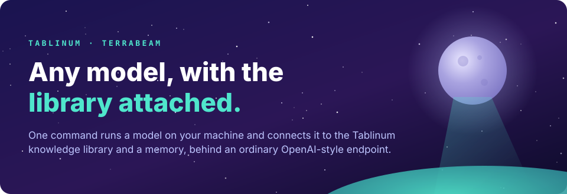
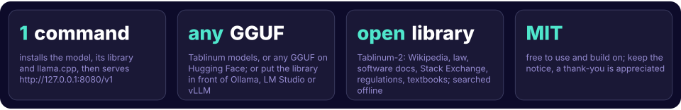

<p align="center"></p>
<p align="center"></p>

**terrabeam** runs a language model on your own computer and connects it to the
[Tablinum](https://huggingface.co/tablinum) knowledge library and a persistent memory. Everything sits behind an ordinary
OpenAI-style endpoint, so it works with the apps you already use.

When you ask a question, terrabeam searches the library (Wikipedia, case law, software documentation, Stack Exchange,
regulations, open textbooks), passes the three best passages to the model, and the model answers from them. Tablinum
models are trained to read those passages and to say so when they don't contain the answer. Any other model gets the
same passages as clearly marked sources.

> **Preview.** The Moon-Beam 8B release and these tools are `-Preview`. The library is now
> [Tablinum-3](https://huggingface.co/datasets/tablinum/tablinum-3): 34 tables, 210M passages, with new agent tables
> (app manuals, web and MCP specs, sysadmin and developer Q&A, scientific code) and home repair.

## Quick start

**1. Install**

```sh
# Linux / macOS
curl -fsSL https://raw.githubusercontent.com/chadstthomas-svg/terrabeam/master/install.sh | sh

# Windows (PowerShell)
irm https://raw.githubusercontent.com/chadstthomas-svg/terrabeam/master/install.ps1 | iex

# or from source (Rust 1.85+; on Linux older than glibc 2.38 add --no-default-features)
cargo install --git https://github.com/chadstthomas-svg/terrabeam terrabeam
```

**2. Run a model**

```sh
terrabeam run tablinum/Moon-Beam-8B-A1B-GGUF-Preview
```

That one command:
- picks the right quant for your GPU or CPU;
- downloads the model, the matching [llama.cpp](https://github.com/ggml-org/llama.cpp) build and the `lite` library pack;
- serves **http://127.0.0.1:8080/v1**.

Downloads are checked against their SHA256 and resume if interrupted. Later starts take seconds.

**3. Use it** with any OpenAI client:

```sh
curl http://127.0.0.1:8080/v1/chat/completions -H 'Content-Type: application/json' \
  -d '{"messages":[{"role":"user","content":"What does PHP json_encode return when it fails?"}]}'
```

The response header `x-engram-sources` lists the passages the model was given.

## Any model, any app

| You have… | Run | Then point your app at |
|---|---|---|
| A Tablinum model | `terrabeam run tablinum/<model>-GGUF-Preview` | `http://127.0.0.1:8080/v1` |
| Any GGUF on Hugging Face | `terrabeam run unsloth/Qwen3-8B-GGUF` (or a local `.gguf`) | `http://127.0.0.1:8080/v1` |
| Ollama, LM Studio, vLLM, llama.cpp, a cloud API | `terrabeam proxy --upstream http://127.0.0.1:11434` | `http://127.0.0.1:8090/v1` |
| Claude Code, Claude Desktop, Cursor, Cline, opencode | `terrabeam mcp` (an MCP tool: `search_library`) | see the guide |

Step-by-step setup for **Open WebUI**, **LM Studio**, **Ollama**, **Claude Code**, **Claude Desktop**, **Cursor**,
**Continue**, **Cline**, **opencode** and **Python** is in **[docs/harnesses.md](docs/harnesses.md)**.

## The library (engram packs)

| Pack | Size | Tables |
|---|---|---|
| `lite` (default) | ~6.6 GB | software docs, app manuals (VS Code, PowerShell, Godot, Blender, LibreOffice, GIMP), web + MCP specs, scientific code, home repair, Stack Exchange (STEM, humanities, finance, law), Britannica 1911, US Code, eCFR |
| `agent` | ~12.4 GB | software docs, app manuals, web + MCP specs, scientific code, developer and sysadmin Q&A (Stack Overflow tooling, Super User, Ask Ubuntu, Server Fault, Unix & Linux …) |
| `standard` | ~31 GB | lite + case law, EUR-Lex, CRS reports, developer and sysadmin Q&A |
| `full` | ~76 GB | standard + English Wikipedia + open textbooks |
| `wiki` | ~34 GB | English Wikipedia only |

The packs nest (`lite` ⊂ `standard` ⊂ `full`), so moving up downloads only the difference. Choose a pack with
`--pack standard`, or pick tables with `--tables software,law`. `terrabeam pack agent` downloads a pack ahead of time;
`terrabeam mcp --pack agent` is the one to give a coding agent. The pack list is read from the published `packs.json`,
so new tables arrive without a new terrabeam release.

Every table keeps its own license (CC BY-SA, CC BY, public domain and others); see
[Tablinum-3 SOURCES](https://huggingface.co/datasets/tablinum/tablinum-3/blob/main/SOURCES.md). Health text is never
included in a pack, whatever its license.

To turn the library off for one request, send `"engram": false` or the header `X-Engram: off`. To run without it, use
`--no-engram`.

## Memory

```sh
terrabeam run tablinum/Moon-Beam-8B-A1B-GGUF-Preview --memory long-term
```

With memory on, terrabeam saves short notes of your questions and the answers. When a later question relates to them, it
adds the matching notes to the system prompt.

- **Modes:**
  - `session`: this conversation only, useful when an app trims long chats;
  - `long-term`: across all your conversations.
- **Safety:** API keys, passwords and bearer tokens are redacted before anything is saved. Retrieved passages are never
  saved. Notes are always marked as untrusted reference material, never as instructions.
- **Managing it:**
  - notes are plain JSONL under `~/.cache/terrabeam/memory/`;
  - `GET /memory` lists them, `DELETE /memory` clears them, and `DELETE /memory/<id>` removes one;
  - to skip memory for one request, send `"memory": false` or the header `X-Memory: off`.

## Commands

| Command | What it does |
|---|---|
| `terrabeam run <model>` | Runs a model with the library and memory. Flags: `--quant`, `--pack`, `--tables`, `--memory`, `--no-engram`, `--cpu`, `--ctx`, `--port`, `-- <llama-server args>` |
| `terrabeam proxy --upstream <url>` | Puts the library and memory in front of a server you already run |
| `terrabeam mcp` | Runs the library (and `--memory`) as an MCP server on stdio |
| `terrabeam pack <name>` | Downloads a pack ahead of time |
| `terrabeam serve` | Runs the library as an HTTP service (`/search`, `/inject`); this is how Rig uses it |

## How it works

- **Retrieval:** pure Rust. It reads the published tables directly:
  - Faiss IVF-SQ8 indexes;
  - Tantivy BM25 for the keyword half of each search;
  - parquet passages;
  - static embeddings for the query;
  - a MiniLM cross-encoder through ONNX Runtime.

  Results match the reference Python implementation (rerank top-1 on 60 of 60 test queries), and it runs about 3× faster.
- **Models:** run by the pinned upstream llama.cpp release. The MTP draft head is used when the model ships one.
- **Proxy:** adds passages to the last user message:
  - **Tablinum models:** in the exact layout they were trained on;
  - **other models:** as clearly marked source blocks.

  Everything else is passed through unchanged, streaming included.

See [DESIGN.md](DESIGN.md) for details.

## Credit and license

MIT. Use it, change it, ship it. Keep the copyright notice, and if terrabeam or the Tablinum research helps you, a
mention or a thank-you is appreciated. See [CITATION.cff](CITATION.cff).

Built by [Tablinum](https://huggingface.co/tablinum).
